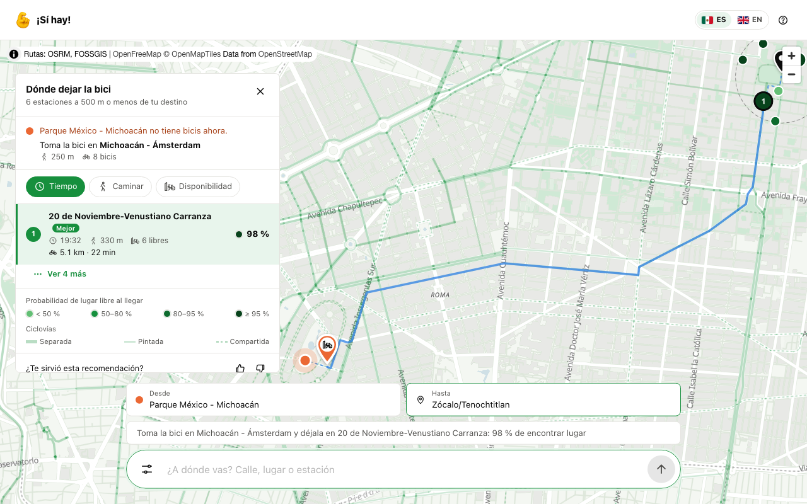
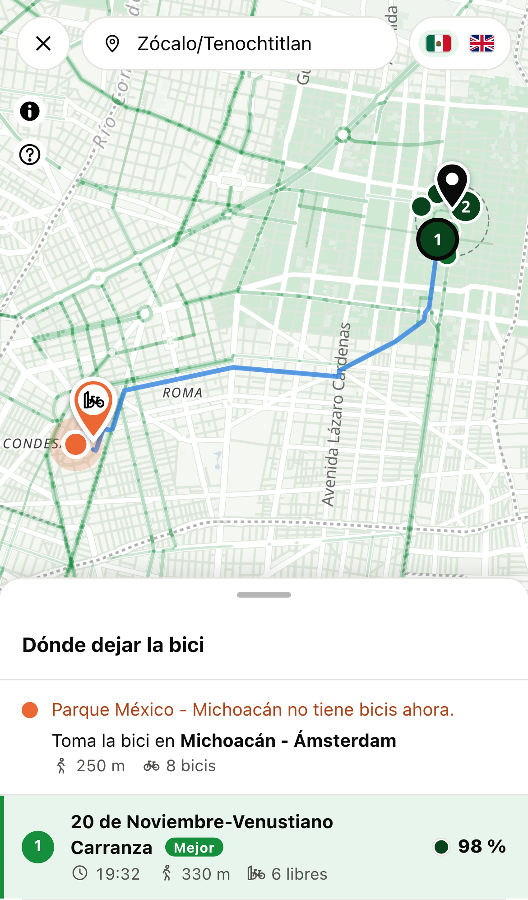
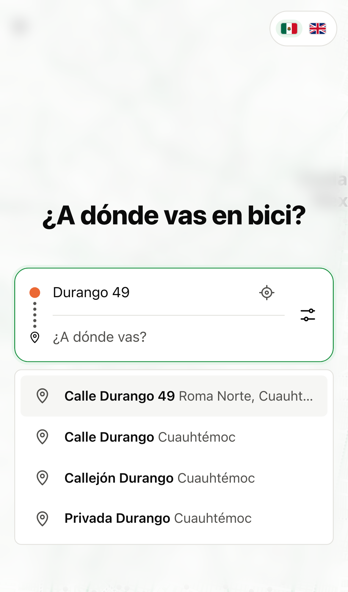
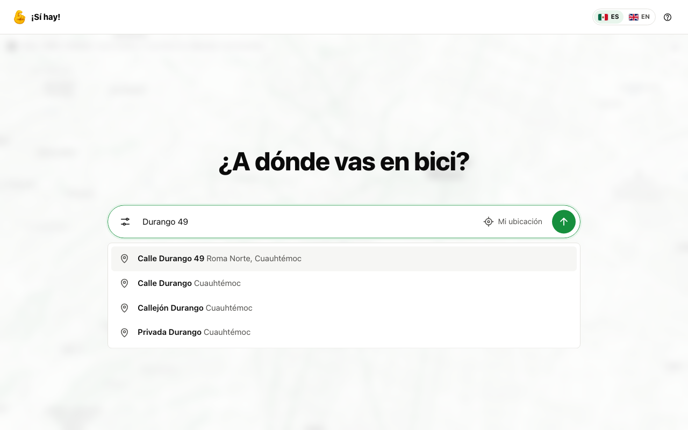

# ¡Sí hay!

**¿Cansado de perder +15 minutos buscando donde dejar tu ecobici?** ¡Sí hay! te dice en qué estación de Ecobici es más probable encontrar un anclaje libre, a la hora en que llegas.

  

Solo escribe de dónde sales y a dónde vas. La app te dice:

- dónde tomar la bici, si tu estación de salida no tiene;
- en qué estación dejarla, con la probabilidad de encontrar lugar libre cuando llegues;
- otras estaciones de respaldo, ordenadas por tiempo, por distancia a pie o por disponibilidad;
- la ruta en el mapa, con las ciclovías de la ciudad.

  
  &nbsp;&nbsp;
  

## Funciones

- **Probabilidad de lugar libre al llegar**
- **Búsqueda por calle y número**
- **Lugares, estaciones y tu ubicación**
- **Tres formas de ordenar:** tiempo, caminata o disponibilidad
- **Mapa con ciclovías**

  

Cada 2 minutos guardamos el estado de todas las estaciones (feed público GBFS de Ecobici). Un modelo LightGBM calcula la probabilidad de que cada estación esté llena a los 15, 30 y 45 minutos. Usa el estado actual, la hora, el día y el clima. Combina la probabilidad con la caminata y el tiempo en bici para elegir la mejor estación y las de respaldo.

## Qué tan bien funciona

En la prueba con datos de octubre a diciembre de 2025, el modelo reduce el error de la probabilidad cerca de 20 % frente a la mejor alternativa simple (suponer que la estación sigue como está). Las probabilidades también están calibradas: cuando dice "80 %", pasa cerca de 8 de cada 10 veces.

El detalle está en [`docs/modeling.md`](docs/modeling.md).

## Más información

| Tema | Documento |
| --- | --- |
| Qué construimos y por qué | [`docs/PRD.md`](docs/PRD.md) |
| Cómo se construyó y se probó el modelo | [`docs/modeling.md`](docs/modeling.md) |
| Plan de ingeniería y decisiones | [`docs/ENG_PLAN.md`](docs/ENG_PLAN.md) |
| Captura, predicción en vivo y evaluación | [`docs/ciclo_en_vivo.md`](docs/ciclo_en_vivo.md) |
| Instalar, probar y desarrollar | [`docs/desarrollo.md`](docs/desarrollo.md) |
| Reportes de cada etapa | [`docs/reports/`](docs/reports/) |

## Licencia

Apache 2.0. Los datos tienen sus propios términos: ver `docs/ENG_PLAN.md` §2.12.
